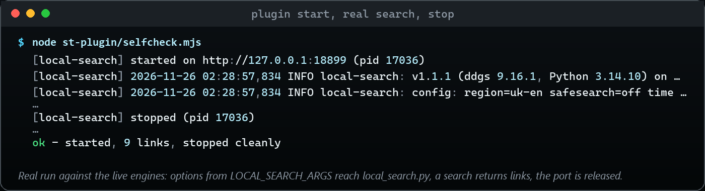
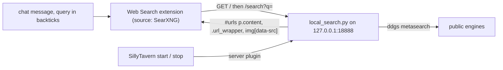

<div align="center">


[](https://github.com/SenjuWoo/SillyTavern-LocalSearch/actions/workflows/ci.yml)
[](https://github.com/SenjuWoo/SillyTavern-LocalSearch/releases/latest)
[](local_search.py)
[](st-plugin/index.mjs)
[](LICENSE)

**[Install](#install)** · **[LM Studio](#using-lm-studio-as-the-model)** · **[Options](#options-and-files)** · **[How it works](#how-it-works)** · **[Deep dives](#deep-dives)** · **[Changelog](CHANGELOG.md)**

</div>

**Keyless web search. Local models that actually answer.**

SillyTavern's Web Search extension ships six sources. None of them is both free and self-contained: SerpApi / Tavily / Serper / Z.AI want keys, KoboldCpp wants KoboldCpp, SearXNG wants an instance. Public SearXNG hosts were measured from this machine and failed (captcha or HTTP 429).

Separately, a local LM Studio model through Chat Completion can look connected and still return nothing: missing API-key field, thinking tokens eating the reply budget, Qwen3 templates rejecting mid-prompt `system` messages as a bare `Bad Request`.

This repo is those two fixes, installed with one double-click: DuckDuckGo behind the SearXNG shape SillyTavern already parses, plus the LM Studio Chat Completion fixes that stop silent empty replies.

## What you get

Five writes. Each exists because something silently misbehaves without it.

| Change | Effect |
| --- | --- |
| `plugins/local-search` junction | SillyTavern starts `local_search.py` on `127.0.0.1:18888` and kills it on shutdown |
| `enableServerPlugins: true` | Required; SillyTavern otherwise loads no server plugin, silently |
| Web Search → SearXNG URL `http://127.0.0.1:18888` | Keyless DuckDuckGo behind the HTML shape the extension already parses |
| Trigger phrases **off**, backticks **on** | Search fires on `` `current version of rust` ``, not on `can you` / `what is` |
| Prompt Post-Processing `semi_tools` | Strict chat templates stop raising `System message must be at the beginning`; tool calling stays on |

Nothing leaves the machine except the search query. Loopback only — do not bind `0.0.0.0`. Every change, and how to undo it, is in [docs/what-it-changes.md](docs/what-it-changes.md).


## Install

**Close SillyTavern first.** While its browser tab is open it writes its own
copy of the settings back over the file, so anything changed underneath is lost.

1. Download this repo (green **Code** button → **Download ZIP**, then unzip, or the zip from the [latest release](https://github.com/SenjuWoo/SillyTavern-LocalSearch/releases/latest)) or:

   ```bash
   git clone https://github.com/SenjuWoo/SillyTavern-LocalSearch
   ```

2. Double-click **`UpdateAndStart.bat`**.

That is it. It installs everything, updates SillyTavern, and starts it — and it
is the same file you double-click every time from then on, instead of
SillyTavern's own `UpdateAndStart.bat`.

`Install.bat` is there if you would rather set things up without updating or
starting anything. Both are safe to re-run; every step checks before it writes.

You need **Python** (from [python.org](https://www.python.org/downloads/), with
*Add python.exe to PATH* ticked) and **Node.js**, which SillyTavern needs anyway.

If SillyTavern is not found it asks once for the path. You can also pass it:

```bash
python install.py --sillytavern "C:\path\to\SillyTavern"
python install.py --dry-run
```

SillyTavern's console should then say:

```
[local-search] started on http://127.0.0.1:18888
```

**To search the web, wrap the query in backticks** in any chat message:

> Hey, can you check `current version of rust` for me?

That is the only thing that triggers a search. See
[Web search fires on almost every roleplay turn](docs/runtime-costs.md#web-search-fires-on-almost-every-roleplay-turn)
for why the alternative is worse.

### Using LM Studio as the model

Load a model in LM Studio and start its server (`lms server start`, or the
toggle in the app). Then in SillyTavern:

**API Connections** → API: **Chat Completion** → Source: **Custom
(OpenAI-compatible)**

| Field | Value |
|---|---|
| Custom Endpoint | `http://127.0.0.1:1234/v1` |
| Custom API Key | any non-empty text, e.g. `local` |
| Prompt Post-Processing | **Semi-strict, tools** |
| Response (tokens) | **1024 or more** |

Every one of those four has a failure mode that looks like something else
entirely. They are documented, with measurements, in
[docs/lm-studio.md](docs/lm-studio.md).

### Updating

Double-click **`UpdateAndStart.bat`**. One click does all of it:

```
Updating tweaks...                     git pull, this repo
updating SillyTavern...                git pull --rebase --autostash
Extension-WebSearch 9c3aa66            fast-forward only, skipped if you edited it
npm install...                         SillyTavern's own dependency step
[ ok ] plugin already linked           re-checks every install step
[local-search] started on ...          and starts SillyTavern
```

Use it instead of SillyTavern's own `UpdateAndStart.bat`. It does the same
update and then re-asserts the settings, because a SillyTavern update can
introduce new settings defaults.

**A SillyTavern update cannot remove these tweaks.** Everything touched here is
in SillyTavern's own `.gitignore` ([details](docs/what-it-changes.md#why-a-sillytavern-update-cannot-remove-them)).

## Options and files

`local_search.py` runs on its own (`Start-LocalSearch.bat`, or `python local_search.py`) or under the server plugin, which passes the same options through `LOCAL_SEARCH_ARGS`.

| Option | Default | What it does |
| --- | --- | --- |
| `--safesearch on/moderate/off` | `moderate` | Engine-side filtering. `off` for unfiltered results |
| `--region` | `us-en` | Result locale, e.g. `uk-en`, `de-de`, `wt-wt` (none) |
| `--timelimit d/w/m/y` | any | Only results from the last day / week / month / year |
| `--backend` | `auto` | ddgs engines: `auto` spreads text searches over several engines, or name them, e.g. `duckduckgo` or `brave,wikipedia` |
| `--max-results` | `10` | Results per search |
| `--cache-ttl` | `600` | Seconds an identical search is answered from memory. `0` = off. Empty answers are never cached |
| `--timeout` | `10` | Per-engine request timeout, seconds |
| `--verbose` | off | One log line per request and cache hit |
| `--host` / `--port` | `127.0.0.1` / `18888` | Bind address and port; there is no auth |

| Environment (plugin) | Does |
| --- | --- |
| `LOCAL_SEARCH_PORT` / `LOCAL_SEARCH_HOST` | Move the endpoint if `18888` is taken |
| `LOCAL_SEARCH_ARGS` | Extra options above, space-separated, e.g. `--safesearch off --region uk-en` |

| File | Does |
| --- | --- |
| `UpdateAndStart.bat` | pull + re-assert + start |
| `Install.bat` / `install.py` | one-shot installer (`--dry-run`, `--update`, `--start`, `--sillytavern`) |
| `Start-LocalSearch.bat` | run the endpoint by hand in a console window |
| `local_search.py` | ddgs metasearch → SearXNG-shaped HTML on 127.0.0.1:18888 |
| `st-plugin/` | SillyTavern server plugin (junction target) |

Full option notes, the log and running it without a window: [docs/web-search.md](docs/web-search.md).



## How it works



- **The contract comes from reading the extension.** `Extension-WebSearch` 1.2.0 parses four selectors out of the returned HTML, and only those are produced. SillyTavern also fetches the base page and a `/client*.css`; both are answered.
- **One shared ddgs client** keeps engine sessions warm, and a 10-minute cache answers swipes and regenerates without re-hitting the engines.
- **A failed upstream returns an empty result page** rather than an error, so a rate-limited search degrades to "no results" instead of breaking generation.
- **The plugin probes the port first**, so running `Start-LocalSearch.bat` by hand still works, and it spawns the resolved Python directly so stopping SillyTavern stops the process that owns the port.

## Tested

```bash
python test_local_search.py          # offline, deterministic
python test_local_search.py --live   # plus the real engines
node st-plugin/argscheck.mjs         # LOCAL_SEARCH_ARGS parsing, offline
node st-plugin/selfcheck.mjs         # start -> real search -> stop -> port released
```


## Deep dives

What was measured to get here. Only worth reading when something misbehaves.

| Doc | Covers |
| --- | --- |
| [What the installer changes](docs/what-it-changes.md) | the five changes one by one, how to undo each, and what is never touched |
| [Free web search](docs/web-search.md) | why none of the built-in sources are free, setting it up by hand, options, log, what the shim implements, limits |
| [LM Studio as a SillyTavern API](docs/lm-studio.md) | four failures that look like connection problems, the preset trap, a note for Hermes users |
| [What this costs at run time](docs/runtime-costs.md) | trigger phrases, Vectors VRAM, reasoning tokens, JIT context length, weights that do not fit |
| [Vectors and Connection Profiles](docs/vectors-and-profiles.md) | local RAG on the same endpoint, one click per backend |

## Honest status

Verified in this tree:

- CI (Python 3.10 and 3.13) runs `python test_local_search.py` offline: `#urls`, `client*.css` href, snippets, absolute links, `data-src` images, empty-query page, escaping, options, cache, upstream failure. The `--live` run against real engines is informational there, because engines rate-limit CI runners
- CI runs `node st-plugin/argscheck.mjs`: `LOCAL_SEARCH_ARGS` splits on whitespace (1.1.0 split on the letter `s`, so the documented example never reached `local_search.py`)
- `node st-plugin/selfcheck.mjs`: plugin start → real search → stop → port released
- Installer steps in `install.py` as listed above
- Tagged GitHub releases: see [Releases](https://github.com/SenjuWoo/SillyTavern-LocalSearch/releases)

Not claimed:

- That the engines will never rate-limit (bursts degrade to empty results, not a crash)
- That `reasoning_effort` / `/no_think` can turn off a reasoning model through the OpenAI-compatible API (measured: they cannot)
- A hosted SearXNG of our own
- Changes to your presets, characters, chats, lorebooks, or other third-party extensions

## License

MIT — see `LICENSE`. The Web Search extension it feeds is a separate project
under AGPL-3.0 and is not redistributed here.
